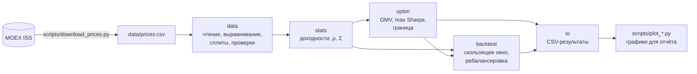
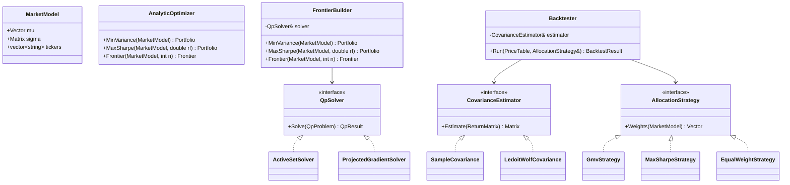
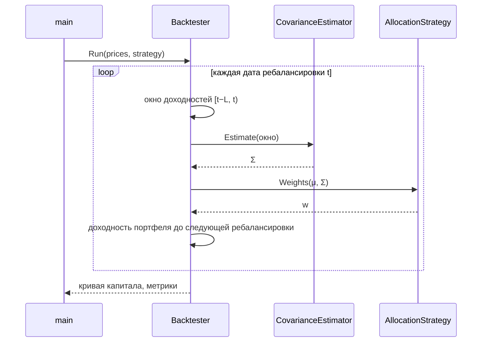

# Архитектура

Статус: v0.2 (19.11.2026). Реализованы модули `data` и `stats`. Требования — в [REQUIREMENTS.md](REQUIREMENTS.md).

## 1. Общая схема

Приложение — конвейер обработки данных. Каждый шаг — отдельный модуль
библиотеки `quant`, консольная утилита только разбирает параметры
и соединяет шаги.



Правило зависимостей: `data → stats → optim → backtest`. Математические модули
(`stats`, `optim`) не знают о файлах и консоли — их можно тестировать
на синтетических данных. Чтение и запись файлов — только в `data` и `io`.

## 2. Модули

| Модуль | Ответственность | Основные типы | Требования |
|---|---|---|---|
| `data` | Чтение CSV, заполнение пропусков, сплиты, поиск аномалий | `PriceTable`, `Split`, `PriceAnomaly`; функции `ReadPriceCsv`, `FillMissingPrices`, `ReadSplitsCsv`, `ApplySplits`, `FindPriceAnomalies` | FR-2…FR-5 |
| `stats` | Доходности, средние, оценки ковариации | `ReturnMatrix`, `CovarianceEstimator` (интерфейс), `SampleCovariance`, `LedoitWolfCovariance`; функции `ComputeSimpleReturns`, `ComputeMeanReturns`, `EstimateLedoitWolf`, `MakeCovarianceEstimator` | FR-6…FR-8 |
| `optim` | Аналитические решения, QP-решатель, эффективная граница | `MarketModel` (μ, Σ), `Portfolio`, `AnalyticOptimizer`, `QpSolver` (интерфейс), `ActiveSetSolver`, `ProjectedGradientSolver`, `FrontierBuilder` | FR-9…FR-15 |
| `backtest` | Скользящее окно, ребалансировка, метрики | `Backtester`, `AllocationStrategy` (интерфейс), `GmvStrategy`, `MaxSharpeStrategy`, `EqualWeightStrategy`, `PerformanceMetrics` | FR-16…FR-19 |
| `io` / `app` | Разбор параметров, запись CSV, сводка в stdout, коды возврата | `CliOptions`, `ResultWriter`, утилита `mpt` (`src/main.cpp`) | FR-20, FR-21, NFR-8 |
| `scripts/` (Python) | Загрузка данных с MOEX, графики | `download_prices.py`, `plot_frontier.py`, `plot_backtest.py` | FR-1, FR-22 |

## 3. Диаграмма классов (ядро)



Паттерн **Strategy** используется трижды: оценка ковариации, QP-решатель
и правило распределения в бэктесте. Это позволяет сравнивать варианты
(выборочная ковариация против Ledoit–Wolf, два решателя, GMV против 1/N)
без изменения остального кода.

## 4. Диаграмма последовательности: бэктест



## 5. Архитектурные решения

### ADR-1. Метод оптимизации без коротких продаж (FR-12…FR-14)

Все три задачи сводятся к одной задаче квадратичного программирования:

> min ½·xᵀQx + cᵀx  при  Ax = b,  x ≥ 0

(для максимального Шарпа: min yᵀΣy при (μ − r_f·1)ᵀy = 1, y ≥ 0,
затем w = y / (1ᵀy); требует, чтобы хотя бы у одного актива μᵢ > r_f).

| Вариант | Плюсы | Минусы |
|---|---|---|
| **(а) Метод активного множества** (свой) | Точное решение за конечное число шагов; быстро для n ≤ 100; без зависимостей | Сложнее реализовать, нужна аккуратность с вырожденными случаями |
| **(б) Проекционный градиентный спуск** (свой) | Очень простой код | Итерационный, медленно сходится при плохой обусловленности Σ, нужно подбирать шаг и точность |
| **(в) Готовый решатель OSQP** | Надёжный, проверенный | Внешняя C-библиотека, усложняет сборку; приближённое решение (ADMM) |

**Решение:** (а) — основной решатель; (б) — эталон для тестов и сравнение
в бенчмарке; (в) — не используем.

**Обоснование:** (а) даёт точность из NFR-2 и скорость из NFR-1 без новых
зависимостей. (б) настолько прост, что почти не может содержать ошибок,
поэтому годится для перекрёстной проверки, а сравнение скорости (а) и (б)
войдёт в отчёт. Риск сложности (а) закрывается тем, что (б) уже будет работать.

### ADR-2. Линейная алгебра

Варианты: Eigen 3 / собственные матрицы / BLAS+LAPACK.
**Решение:** Eigen 3 — стандарт в индустрии, только заголовки, есть
разложения Холецкого и LDLᵀ для решения систем. Подключается через
`find_package`, при отсутствии — через `FetchContent`.

### ADR-3. Хранение данных

Варианты: CSV-файлы / SQLite.
**Решение:** CSV в широком формате (`date,TICKER1,...`). Объём маленький
(~1700 дней × 20 бумаг), файлы удобно смотреть глазами и класть в репозиторий
для воспроизводимости (NFR-3). Сплиты — отдельный `splits.csv` (`date,ticker,ratio`).

### ADR-4. Аналитическое решение с короткими продажами (FR-9…FR-11)

Решается через множители Лагранжа: GMV — w = Σ⁻¹1 / (1ᵀΣ⁻¹1), касательный
портфель — w ∝ Σ⁻¹(μ − r_f·1), граница — линейная комбинация двух портфелей.
Системы решаются разложением LDLᵀ без явного обращения Σ (устойчивее
численно). Если Σ вырождена — ошибка с предложением использовать Ledoit–Wolf.

### ADR-5. Параллельность бэктеста (C)

Расчёты на разных датах ребалансировки независимы, их можно запускать
через `std::async`. Делаем только если останется время; эффект измеряем
бенчмарком.

### ADR-6. Обработка ошибок

Библиотека бросает исключения (`std::invalid_argument`, `std::runtime_error`
с понятным текстом). `main` перехватывает их, печатает сообщение в stderr
и возвращает код 1 (некорректный ввод) или 2 (ошибка расчёта).

## 6. Целевая структура репозитория

```
include/quant/{data,stats,optim,backtest,io}/   заголовки
src/{data,stats,optim,backtest,io}/             реализация библиотеки mpt_core
src/main.cpp                                    консольная утилита mpt
tests/, tests/data/                             unit-тесты (GoogleTest) и тестовые CSV
bench/                                          бенчмарки (Google Benchmark)
data/prices.csv, data/splits.csv                данные для воспроизводимого запуска
scripts/                                        Python: загрузка данных, графики
docs/                                           требования, архитектура, план, Doxyfile
report/                                         отчёт LaTeX и PDF
Dockerfile
```

## 7. Трассировка требований

Заполняется по мере реализации: требование → модуль → тест. ✅ — реализовано и покрыто тестами.

| Требование | Модуль | Тест |
|---|---|---|
| FR-1 ✅ | `scripts/download_prices.py` | проверен на имитации ответов ISS; реальная выгрузка — вручную |
| FR-2 ✅ | `data` | `ReadPriceCsv.*` в `test_data.cpp` |
| FR-3 ✅ | `data` | `FillMissingPrices.*` |
| FR-4 ✅ | `data` | `Splits.*` |
| FR-5 ✅ | `data` | `Anomalies.DetectsUnadjustedSplit` |
| FR-6 ✅ | `stats` | `Returns.*`, `Covariance.SampleMatchesNumpy` в `test_stats.cpp` |
| FR-7 ✅ | `stats` | `Covariance.LedoitWolfMatchesSklearn`, `Covariance.LedoitWolfIsWellConditioned…` |
| FR-8 ✅ | `stats` | `Covariance.FactoryByName` |
| FR-9…FR-11 | `optim` | `test_analytic.cpp` |
| FR-12…FR-14 | `optim` | `test_qp.cpp` |
| FR-16…FR-18 | `backtest` | `test_backtest.cpp` |
| FR-20, FR-21, NFR-8 | `io`/`app` | `test_cli.cpp` |
| NFR-1 | `optim` | `bench/bench_frontier.cpp` |
| NFR-2 | `optim` | `test_qp.cpp` |
| NFR-4 ✅ | `Dockerfile` | сборка образа с прогоном тестов; `docker run --rm mpt` |
| NFR-5 ✅ | `.clang-format`, `.clang-tidy` | задача `style` в CI |
